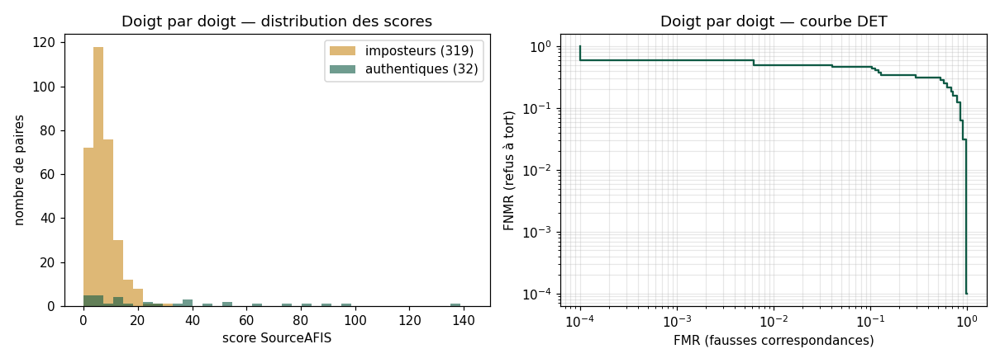
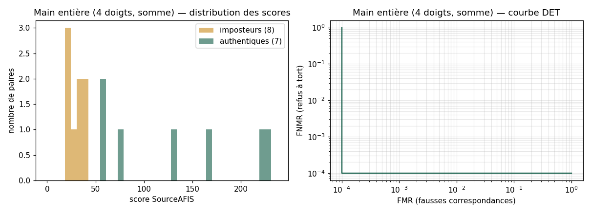

# Premier signal (découpes nettes, comparaison multi-échelle)

> Généré le 01/10/2026 par `evaluation/evaluer.py`. Prototype non officiel.
> Aucune image d'empreinte dans ce rapport : seulement des scores.

## Données

| | |
|---|---|
| Personnes | 1 |
| Sessions de capture | 4 |
| Découpes de doigts | 27 |
| Filtre | netteté des crêtes ≥ 0.04 (sessions de l'étape 3c uniquement) ; comparaison multi-échelle (±15 %) |

Paires **authentiques** : même doigt de la même personne, sessions différentes.
Paires **imposteur** : doigts différents (autre doigt ou autre personne).

## Résultats par variante de prétraitement

### Doigt par doigt

| Variante | Authentiques | Imposteurs | EER | d' | Médiane authentique | Max imposteur | FNMR à FMR 1 % |
|---|---|---|---|---|---|---|---|
| gabor_inverse | 32 | 319 | 31.6 % | 0.85 | 15.0 | 27.7 | 59.4 % |
| simple_inverse ⭐ | 32 | 319 | 31.3 % | 1.06 | 20.9 | 30.7 | 50.0 % |
| simple_direct | 32 | 319 | 34.4 % | 0.91 | 15.3 | 25.3 | 62.5 % |
| gabor_inverse_largeur | 32 | 319 | 31.3 % | 0.86 | 18.2 | 29.6 | 56.2 % |

### Main entière (4 doigts fusionnés)

| Variante | Fusion | Authentiques | Imposteurs | EER | d' | Médiane authentique | Max imposteur | Rang 1 |
|---|---|---|---|---|---|---|---|---|
| gabor_inverse | somme | 7 | 8 | 26.8 % | 1.76 | 110.6 | 43.1 | 100.0 % |
| gabor_inverse | 3 meilleurs | 7 | 8 | 26.8 % | 1.73 | 100.7 | 37.0 |  |
| simple_inverse | somme | 7 | 8 | 0.0 % | 2.12 | 129.8 | 40.6 | 100.0 % |
| simple_inverse | 3 meilleurs | 7 | 8 | 0.0 % | 2.13 | 126.3 | 37.1 |  |
| simple_direct | somme | 7 | 8 | 13.4 % | 1.94 | 96.6 | 40.8 | 100.0 % |
| simple_direct | 3 meilleurs | 7 | 8 | 13.4 % | 1.90 | 88.6 | 36.1 |  |
| gabor_inverse_largeur | somme | 7 | 8 | 13.4 % | 1.45 | 95.4 | 56.1 | 100.0 % |
| gabor_inverse_largeur | 3 meilleurs | 7 | 8 | 13.4 % | 1.44 | 88.1 | 44.9 |  |

## Meilleure variante : `simple_inverse`

- Seuil à l'EER (doigt) : 8.5 ; seuil pour FMR ≤ 1 % : 22.0.
- Découpes impossibles à traiter : 0.

## Limites

- Avec 319 paires imposteur, on ne peut pas affirmer un FMR inférieur à 0.9 % (règle des 3).
- Les variantes sont choisies sur ces mêmes données : le résultat est optimiste. À confirmer sur de nouvelles captures.
- **Une seule personne** : les imposteurs sont ses autres doigts. Cela mesure si un doigt se reconnaît d'une session à l'autre, pas la fiabilité sur une population.
