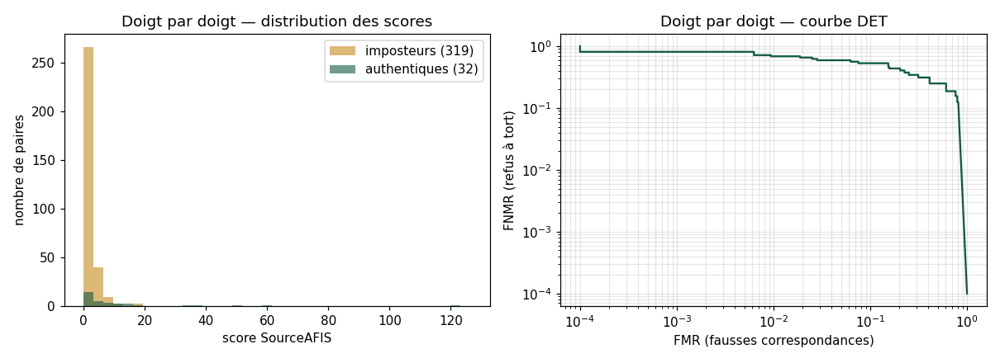
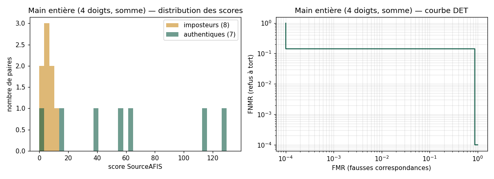

# Premier signal (découpes nettes seulement)

> Généré le 01/10/2026 par `evaluation/evaluer.py`. Prototype non officiel.
> Aucune image d'empreinte dans ce rapport : seulement des scores.

## Données

| | |
|---|---|
| Personnes | 1 |
| Sessions de capture | 4 |
| Découpes de doigts | 27 |
| Filtre | netteté des crêtes ≥ 0.04 (sessions de l'étape 3c uniquement) |

Paires **authentiques** : même doigt de la même personne, sessions différentes.
Paires **imposteur** : doigts différents (autre doigt ou autre personne).

## Résultats par variante de prétraitement

### Doigt par doigt

| Variante | Authentiques | Imposteurs | EER | d' | Médiane authentique | Max imposteur | FNMR à FMR 1 % |
|---|---|---|---|---|---|---|---|
| gabor_inverse | 32 | 319 | 40.7 % | 0.62 | 2.4 | 12.1 | 65.6 % |
| gabor_direct | 32 | 319 | 37.6 % | 0.60 | 4.2 | 18.4 | 68.8 % |
| simple_inverse | 32 | 319 | 34.9 % | 0.72 | 3.0 | 9.9 | 65.6 % |
| simple_direct ⭐ | 32 | 319 | 31.3 % | 0.69 | 3.6 | 17.9 | 68.8 % |
| gabor_inverse_vert | 32 | 319 | 33.6 % | 0.61 | 5.6 | 19.8 | 68.8 % |
| gabor_inverse_largeur | 32 | 319 | 35.1 % | 0.80 | 4.9 | 14.7 | 65.6 % |

### Main entière (4 doigts fusionnés)

| Variante | Fusion | Authentiques | Imposteurs | EER | d' | Médiane authentique | Max imposteur | Rang 1 |
|---|---|---|---|---|---|---|---|---|
| gabor_inverse | somme | 7 | 8 | 13.4 % | 1.65 | 62.6 | 11.0 | 100.0 % |
| gabor_inverse | 3 meilleurs | 7 | 8 | 13.4 % | 1.65 | 62.6 | 11.0 |  |
| gabor_direct | somme | 7 | 8 | 26.8 % | 1.45 | 61.2 | 24.6 | 100.0 % |
| gabor_direct | 3 meilleurs | 7 | 8 | 26.8 % | 1.46 | 59.1 | 20.6 |  |
| simple_inverse | somme | 7 | 8 | 13.4 % | 1.47 | 37.8 | 18.1 | 100.0 % |
| simple_inverse | 3 meilleurs | 7 | 8 | 13.4 % | 1.45 | 35.1 | 15.8 |  |
| simple_direct | somme | 7 | 8 | 13.4 % | 1.72 | 55.7 | 12.4 | 100.0 % |
| simple_direct | 3 meilleurs | 7 | 8 | 13.4 % | 1.70 | 55.6 | 12.4 |  |
| gabor_inverse_vert | somme | 7 | 8 | 13.4 % | 1.54 | 38.9 | 14.8 | 100.0 % |
| gabor_inverse_vert | 3 meilleurs | 7 | 8 | 13.4 % | 1.53 | 38.7 | 12.5 |  |
| gabor_inverse_largeur | somme | 7 | 8 | 13.4 % | 1.52 | 47.2 | 12.1 | 100.0 % |
| gabor_inverse_largeur | 3 meilleurs | 7 | 8 | 13.4 % | 1.51 | 46.8 | 11.2 |  |

## Meilleure variante : `simple_direct`

- Seuil à l'EER (doigt) : 1.8 ; seuil pour FMR ≤ 1 % : 11.2.
- Découpes impossibles à traiter : 0.

## Limites

- Avec 319 paires imposteur, on ne peut pas affirmer un FMR inférieur à 0.9 % (règle des 3).
- Les variantes sont choisies sur ces mêmes données : le résultat est optimiste. À confirmer sur de nouvelles captures.
- **Une seule personne** : les imposteurs sont ses autres doigts. Cela mesure si un doigt se reconnaît d'une session à l'autre, pas la fiabilité sur une population.
