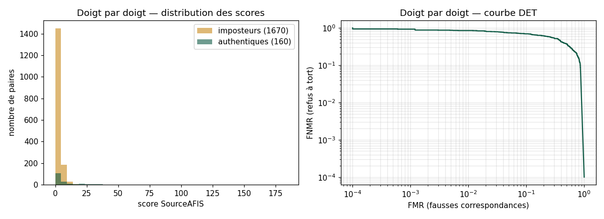
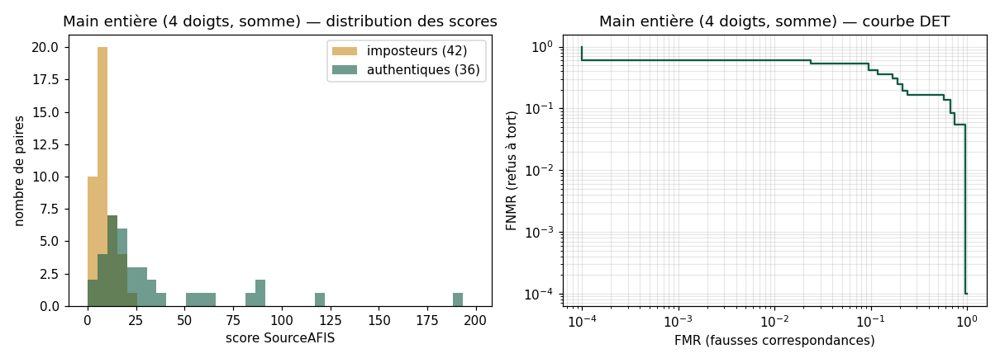

# Premier signal : reconnaissance d'une personne d'une session à l'autre

> Généré le 01/10/2026 par `evaluation/evaluer.py`. Prototype non officiel.
> Aucune image d'empreinte dans ce rapport : seulement des scores.

## Données

| | |
|---|---|
| Personnes | 1 |
| Sessions de capture | 7 |
| Découpes de doigts | 61 |
| Filtre | toutes les découpes |

Paires **authentiques** : même doigt de la même personne, sessions différentes.
Paires **imposteur** : doigts différents (autre doigt ou autre personne).

## Résultats par variante de prétraitement

### Doigt par doigt

| Variante | Authentiques | Imposteurs | EER | d' | Médiane authentique | Max imposteur | FNMR à FMR 1 % |
|---|---|---|---|---|---|---|---|
| gabor_inverse | 160 | 1670 | 44.4 % | 0.42 | 2.0 | 25.9 | 86.9 % |
| gabor_direct ⭐ | 160 | 1670 | 41.9 % | 0.44 | 2.1 | 28.3 | 85.0 % |
| simple_inverse | 160 | 1670 | 41.9 % | 0.48 | 2.0 | 19.7 | 84.4 % |
| simple_direct | 160 | 1670 | 41.3 % | 0.53 | 1.9 | 19.9 | 83.1 % |
| gabor_inverse_vert | 160 | 1670 | 41.1 % | 0.46 | 2.4 | 29.2 | 84.4 % |
| gabor_inverse_largeur | 160 | 1670 | 40.6 % | 0.55 | 2.2 | 25.4 | 80.0 % |

### Main entière (4 doigts fusionnés)

| Variante | Fusion | Authentiques | Imposteurs | EER | d' | Médiane authentique | Max imposteur | Rang 1 |
|---|---|---|---|---|---|---|---|---|
| gabor_inverse | somme | 36 | 42 | 28.2 % | 0.95 | 15.6 | 24.0 | 100.0 % |
| gabor_inverse | 3 meilleurs | 36 | 42 | 28.2 % | 0.95 | 14.7 | 23.0 |  |
| gabor_direct | somme | 36 | 42 | 21.8 % | 0.93 | 17.6 | 24.6 | 100.0 % |
| gabor_direct | 3 meilleurs | 36 | 42 | 21.8 % | 0.92 | 17.2 | 20.6 |  |
| simple_inverse | somme | 36 | 42 | 30.8 % | 0.93 | 20.7 | 18.1 | 100.0 % |
| simple_inverse | 3 meilleurs | 36 | 42 | 30.8 % | 0.92 | 20.1 | 15.8 |  |
| simple_direct | somme | 36 | 42 | 25.6 % | 1.13 | 21.5 | 18.5 | 100.0 % |
| simple_direct | 3 meilleurs | 36 | 42 | 25.6 % | 1.13 | 21.4 | 17.6 |  |
| gabor_inverse_vert | somme | 36 | 42 | 25.6 % | 0.96 | 20.5 | 37.5 | 100.0 % |
| gabor_inverse_vert | 3 meilleurs | 36 | 42 | 21.8 % | 0.95 | 19.7 | 36.5 |  |
| gabor_inverse_largeur | somme | 36 | 42 | 25.6 % | 1.13 | 23.5 | 24.0 | 100.0 % |
| gabor_inverse_largeur | 3 meilleurs | 36 | 42 | 25.6 % | 1.12 | 23.1 | 21.9 |  |

## Meilleure variante : `gabor_direct`

- Seuil à l'EER (doigt) : 1.7 ; seuil pour FMR ≤ 1 % : 12.0.
- Découpes impossibles à traiter : 0.

## Limites

- Avec 1670 paires imposteur, on ne peut pas affirmer un FMR inférieur à 0.2 % (règle des 3).
- Les variantes sont choisies sur ces mêmes données : le résultat est optimiste. À confirmer sur de nouvelles captures.
- **Une seule personne** : les imposteurs sont ses autres doigts. Cela mesure si un doigt se reconnaît d'une session à l'autre, pas la fiabilité sur une population.
